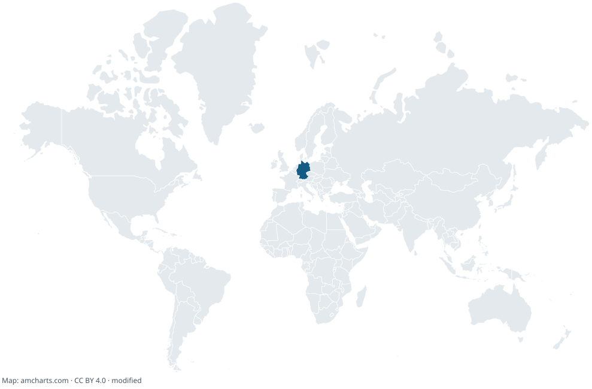
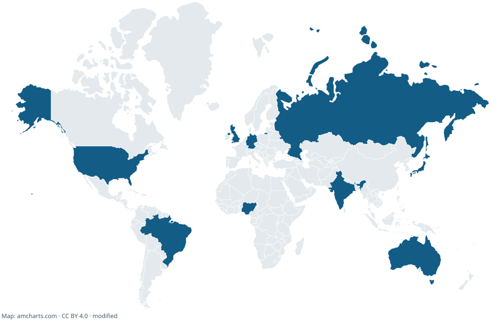

# Contributors Map

A standalone Mercator map of the countries reported in a GitHub repository's contributor profiles. Antarctica is omitted, and Russia's antimeridian fragments are joined to its eastern edge. The same country resolver and SVG renderer power the browser and CLI.

## Run locally

Requires Node.js 22.12 or newer.

```sh
npm ci
npm start
```

Open [localhost](http://127.0.0.1:4173). Enter a public repository, or choose **Try sample data** for an offline demonstration. The browser needs no runtime dependencies or build; any static HTTP server can serve it.

- Generate fetches contributors and their public profile locations, with pagination and four concurrent profile requests.
- Choose a limit of 12, 24 (default), 100, or 500 contributors; partial coverage is explicitly labeled.
- Light, dark, and GitHub blue themes use the same country geometry, including before generation.
- Requests time out after 15 seconds; Cancel stops outstanding work. Profile progress, asset retry, and clear errors preserve the last successful map.
- Country counts remain available as text on small screens and to assistive technology.
- Download SVG produces a standalone image with country titles and amCharts attribution.
- Copy page link preserves the generated repository and selected theme. It opens the generator, not an SVG endpoint.

## Country matching

Country names, common aliases, and uppercase country codes (alone or at the end of a comma-separated location) map to the SVG's IDs. Whole-name matching distinguishes Niger/Nigeria and Dominica/Dominican Republic. Every one of the 256 retained map region names is tested against its exact ID.

Locations are self-reported, not verified geography. Cities alone are not geocoded. Missing, unrecognized, or multiple-country locations count as unmapped. A place name that is also a country name, such as Georgia, is treated as the country unless a final explicit country code disambiguates it. Aliases are intentionally limited; this is not a multilingual geocoder. Antarctica is not mapped. Shading indicates presence, not contribution volume.

GitHub's unauthenticated API limit may prevent loading larger repositories; failed requests produce an error and retain the previous map. Successful results are cached for five minutes in memory. There is no hourly map refresh; refresh manually or schedule the CLI in your own environment.

## Export for a README

Download the SVG, commit it as `map.svg` to your repository, and embed:

```md

```

Or generate it from the terminal:

```sh
MAP_OWNER=ux-git MAP_REPO=contributors-map-widget npm run generate
```

An optional `GITHUB_TOKEN` environment variable is supported by the CLI only. Never put a token into frontend files. The CLI checks up to 500 contributors. To generate the explicitly labeled demonstration:

```sh
npm run generate -- --sample
```



## Tests and map preparation

```sh
npm run check
npm run test:browser
npm run prepare:map
```

Browser tests use installed Google Chrome locally and Playwright Firefox/WebKit. CI installs its own browsers. Run `npx playwright install firefox webkit` for local cross-engine testing. Coverage includes 1440px desktop, 768px tablet, 375px mobile, and 320px narrow layouts, plus keyboard access, text reflow, and axe accessibility checks in all three map themes. Screenshots and failure traces go to ignored `test-results/`.

On the current macOS host, Firefox cannot launch its isolated profile; Chromium and WebKit have passed. To reproduce the verified local subset: `TEST_DIST=1 npm run test:browser -- --project=desktop --project=tablet --project=mobile --project=small --project=webkit`. Firefox remains enabled in the full suite and CI; its local launch failure is not counted as a pass.

Preparation starts with the checked-in original SVG, removes AQ, translates only Russia's left-edge polygons by the exact 960-unit world width, unions touching fragments to eliminate cut seams, and calculates a padded viewBox. Other country geometry is untouched. Regeneration is deterministic and does not need the network.

See [validation](VALIDATION.md), [task status](TODO.md), [project status](PROJECT_STATUS.md), [decisions](DECISIONS.md), and [change history](CHANGELOG.md).

## Production build and hosting

```sh
npm ci
npm run check
npm run format:check
npm run build
npm run verify:build
npm run preview
```

The production preview runs at [localhost:4174](http://127.0.0.1:4174). `dist/` contains only 12 public runtime/assets files plus a SHA-256 manifest. Deploy **only the contents of `dist/`** to an HTTPS static host; no Node server, backend, or runtime packages are needed. Relative URLs support a subdirectory deployment. The build contains no tests, source SVG originals, repository metadata, or development packages.

The preview server is for local verification, binds to loopback, and serves an explicit file allowlist. It supports GET/HEAD only and sets content types, `nosniff`, a referrer policy, and a content security policy. On a real host, configure these headers there (static files cannot set HTTP headers). The reference CSP is in `scripts/serve.mjs`; it allows local modules/assets, GitHub API connections, and inline SVG styling. Use revalidation or short caching for HTML, JS, and data because filenames are not content-hashed. No publishing credentials are required for this project’s build.

`.github/workflows/check.yml` runs dependency installation, tests, formatting, audit, artifact verification, and all browser engines on Ubuntu, then uploads the static build as an artifact. On `main`, successful validation deploys only `dist/` to the existing [GitHub Pages site](https://ux-git.github.io/contributors-map-widget/). Pull requests validate without deploying. Documentation-only pushes do not redeploy; a manual workflow run is available. Generated maps are never automatically committed. See PROJECT_STATUS.md for the actual verified release.

## Source and license

Map geometry: [amCharts Mercator SVG](https://www.amcharts.com/static/svg-maps/worldLow.svg), linked from the [requested map page](https://www.amcharts.com/svg-maps/world-equal-earth/#mercator), retrieved 2026-10-18. Licensed [CC BY 4.0](https://creativecommons.org/licenses/by/4.0/). Original attribution is preserved in a modified footer; exports retain credit and modification disclosure. Original source is stored in `data/world-mercator.original.svg` for reproducibility; only the prepared geometry is displayed/exported.
